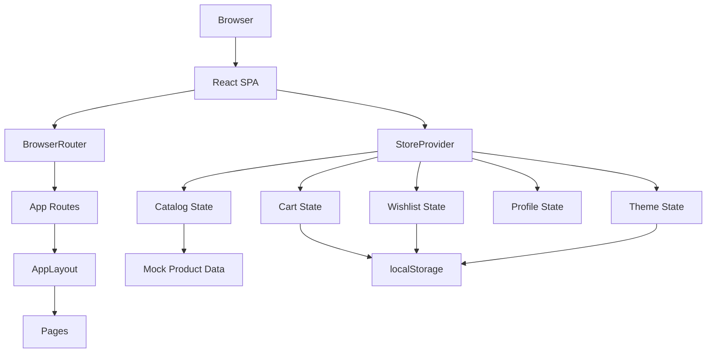
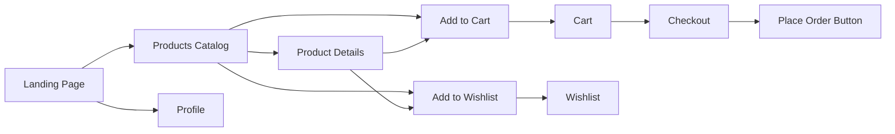
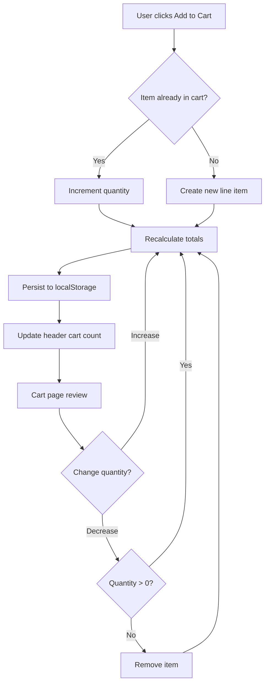
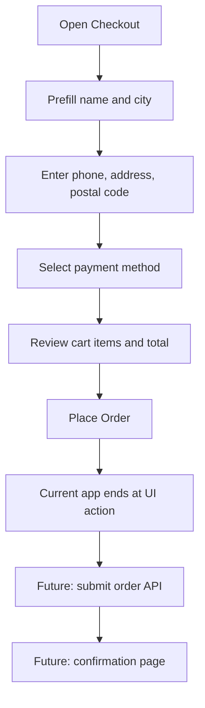
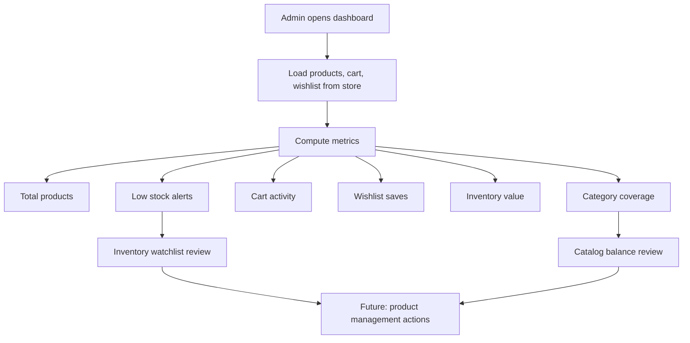

# ShopNest React eCommerce Application
## Enterprise Project Documentation

## Table of Contents
1. [Executive Summary](#1-executive-summary)
2. [System Architecture](#2-system-architecture)
3. [Application Workflow](#3-application-workflow)
4. [Feature Documentation](#4-feature-documentation)
5. [Component Documentation](#5-component-documentation)
6. [Folder Structure Documentation](#6-folder-structure-documentation)
7. [API Contract Documentation](#7-api-contract-documentation)
8. [Testing Documentation](#8-testing-documentation)
9. [Deployment Workflow](#9-deployment-workflow)
10. [Developer Onboarding Guide](#10-developer-onboarding-guide)
11. [Mermaid Diagrams](#11-mermaid-diagrams)
12. [Troubleshooting Guide](#12-troubleshooting-guide)
13. [Current Scope and Non-Functional Notes](#13-current-scope-and-non-functional-notes)

---

## 1. Executive Summary

### 1.1 Project Overview
ShopNest is a React-based eCommerce storefront prototype built with Vite, React Router, Tailwind CSS, and the React Context API. The application provides a complete front-end shopping experience that includes catalog discovery, product details, cart operations, wishlist management, checkout data capture, account profile updates, and an administrative monitoring dashboard.

The application is currently implemented as a UI-first product using a mock product catalog and browser-side persistence through `localStorage`. It is suitable for product demonstration, UX validation, workflow review, and future integration with a backend commerce platform.

### 1.2 Business Objective
The business objective of ShopNest is to provide a modern digital commerce experience that allows teams to:
- Validate customer shopping workflows before backend integration
- Demonstrate marketplace-style browsing and merchandising
- Evaluate reusable front-end architecture for future scale-out
- Support stakeholder review across product, engineering, QA, and support teams
- Serve as a foundation for a production-ready commerce implementation

### 1.3 Target Users
#### Primary Users
- Online retail customers browsing and purchasing products
- Returning shoppers managing saved items and profile details

#### Secondary Users
- Product owners reviewing end-to-end customer journeys
- QA teams validating shopping and admin flows
- Developers extending the storefront into a production system
- Support teams understanding user-facing behavior

#### Administrative Users
- Merchandising or catalog managers monitoring inventory distribution
- Business stakeholders reviewing catalog breadth, low-stock items, cart activity, and wishlist trends

### 1.4 Key Features
- Marketplace-style landing page with promotional sections
- Search across product title, category, and brand
- Product catalog with category filtering, sorting, and pagination
- Product details page with specifications and related recommendations
- Shopping cart with quantity controls and price calculation
- Wishlist persistence and quick-save interactions
- Checkout form with address and payment method selection
- Profile management with editable account information
- Recent orders summary in the account page
- Admin dashboard with inventory and category insights
- Dark/light theme toggle persisted in browser storage
- Client-side persistence for cart, wishlist, and theme

---

## 2. System Architecture

### 2.1 Frontend Architecture
The application follows a client-side single-page application architecture.

#### Architectural Style
- **Presentation layer**: React functional components
- **Navigation layer**: React Router browser routing
- **State layer**: Centralized React Context provider
- **Data layer**: Static product dataset plus browser `localStorage`
- **Styling layer**: Tailwind CSS utilities with custom theme extensions

#### Technology Stack
- **Build tool**: Vite 5
- **Framework**: React 18
- **Routing**: React Router DOM 7
- **Styling**: Tailwind CSS 3 + PostCSS + Autoprefixer
- **State management**: React Context API + hooks
- **Persistence**: Browser `localStorage`

### 2.2 Runtime Composition
- `main.jsx` bootstraps the application
- `BrowserRouter` manages client-side route resolution
- `StoreProvider` supplies global state and actions
- `App.jsx` maps routes to page-level views
- `AppLayout.jsx` renders shared shell elements such as header, footer, search, counters, and theme toggle

### 2.3 Component Hierarchy
```text
main.jsx
└── BrowserRouter
    └── StoreProvider
        └── App
            └── AppLayout
                ├── Header / Navigation / Search / Theme / Counters
                ├── Routed Page Content
                │   ├── HomePage
                │   │   ├── SectionHeader
                │   │   └── ProductCard*
                │   ├── ProductsPage
                │   │   ├── SectionHeader
                │   │   └── ProductCard*
                │   ├── ProductDetailsPage
                │   │   └── ProductCard* (related products)
                │   ├── CartPage
                │   ├── WishlistPage
                │   │   └── ProductCard*
                │   ├── CheckoutPage
                │   ├── ProfilePage
                │   ├── AdminDashboardPage
                │   └── NotFoundPage
                └── Footer
```
`*` indicates repeated reusable component usage.

### 2.4 Routing Architecture
| Route | Component | Purpose |
|---|---|---|
| `/` | `HomePage` | Landing page and promotional entry point |
| `/home` | `Navigate` | Redirects to `/` |
| `/products` | `ProductsPage` | Product listing, filter, sort, pagination |
| `/products/:id` | `ProductDetailsPage` | Product details and related items |
| `/cart` | `CartPage` | Cart review and quantity management |
| `/wishlist` | `WishlistPage` | Saved items overview |
| `/checkout` | `CheckoutPage` | Delivery and payment data capture |
| `/profile` | `ProfilePage` | Shopper profile and recent orders |
| `/admin` | `AdminDashboardPage` | Store metrics and inventory insights |
| `*` | `NotFoundPage` | Fallback for unsupported routes |

### 2.5 State Management Flow
A single `StoreContext` acts as the application store.

#### State Domains
- `allProducts`: in-memory product catalog loaded from `data/products.js`
- `cartItems`: cart line items including quantity
- `wishlistItems`: saved products
- `searchText`: shared search term used across layout and catalog
- `theme`: light or dark mode preference
- `user`: current shopper profile object
- `profileForm`: editable profile draft state
- `orders`: static recent order summary list

#### Derived State
- `cartCount`
- `wishlistCount`
- `cartSubtotal`
- `deliveryFee`
- `tax`
- `grandTotal`

#### Store Actions
- `setSearchText`
- `addToCart`
- `updateCartQuantity`
- `removeFromCart`
- `addToWishlist`
- `removeFromWishlist`
- `isInWishlist`
- `setTheme`
- `setProfileForm`
- `saveProfile`

#### Persistence Flow
1. App initializes.
2. `StoreProvider` reads `junior-cart`, `junior-wishlist`, and `junior-theme` from `localStorage`.
3. Context state is hydrated.
4. User actions mutate state through context functions.
5. A `useEffect` syncs state back to `localStorage`.
6. `document.title` and `document.body.className` are updated as side effects.

---

## 3. Application Workflow

### 3.1 User Journey

#### 3.1.1 Landing Page Workflow
1. User lands on `/`.
2. Hero section introduces the storefront and key value proposition.
3. User can:
   - Click **Start Shopping** to open `/products`
   - Click **Open Dashboard** to open `/admin`
   - Browse featured and deal sections rendered with reusable product cards
4. Product cards support immediate wishlist and cart actions.
5. Global header remains available for search, navigation, theme switching, wishlist, and cart access.

#### 3.1.2 Product Search Workflow
1. User enters a query in the header search box.
2. `searchText` updates in `StoreContext`.
3. `ProductsPage` consumes `searchText`.
4. Catalog filters products where title, category, or brand contains the query.
5. Matching products are displayed with current category and sort settings.
6. Pagination reflects the filtered result set.

#### 3.1.3 Product View Workflow
1. User opens `/products` or clicks a product card.
2. On `/products`, user can:
   - Select a category
   - Choose a sort mode
   - Move between pages
3. User clicks a product title to open `/products/:id`.
4. Product details page loads selected product by route parameter.
5. User reviews image, price, ratings, description, brand, and specifications.
6. User may add the product to cart or wishlist.
7. Related products from the same category are shown for cross-sell discovery.

#### 3.1.4 Cart Workflow
1. User adds a product from landing page, catalog page, or details page.
2. Context checks whether the product is already in the cart.
3. If present, quantity increments; otherwise, a new cart line is created.
4. Cart badge in the header updates using `cartCount`.
5. User opens `/cart`.
6. Cart page displays items, descriptions, price, quantity controls, and removal option.
7. Totals are recalculated automatically:
   - subtotal
   - delivery
   - tax
   - grand total
8. User proceeds to checkout.

#### 3.1.5 Checkout Workflow
1. User opens `/checkout` from the cart.
2. Checkout page pre-fills `fullName` and `city` from the profile.
3. User enters phone number, address, and postal code.
4. User selects a payment method:
   - UPI
   - Credit / Debit Card
   - Cash on Delivery
5. Order review panel shows cart items and payable total.
6. Estimated delivery date is computed dynamically.
7. User clicks **Place Order**.
8. Current implementation stops at UI interaction; no order submission API or success page exists yet.

#### 3.1.6 Order Completion Workflow
**Current implemented state:** partial.
- The interface provides a **Place Order** action but does not persist an order, clear the cart, or navigate to a confirmation page.

**Recommended future workflow contract:**
1. Validate form.
2. Submit checkout payload to order API.
3. Receive order ID and confirmation summary.
4. Clear cart state.
5. Navigate to an order success page.
6. Expose order in profile/order history.

### 3.2 Admin Journey

### 3.2.1 Dashboard Workflow
1. Admin opens `/admin`.
2. Dashboard reads product, cart, and wishlist state from `StoreContext`.
3. Dashboard calculates:
   - total products
   - low stock count
   - cart activity
   - wishlist saves
   - inventory value
   - category distribution
4. Admin reviews low-stock watchlist and category coverage bars.

### 3.2.2 Product Management Workflow
**Current implemented state:** monitoring only.
- Dedicated create, edit, delete, or inventory update screens are not yet implemented.
- The dashboard supports product management indirectly through read-only inventory visibility.

**Recommended future workflow contract:**
1. Admin opens product management module.
2. Search or filter product catalog.
3. Create or edit title, brand, category, pricing, media, stock, and specifications.
4. Save changes to backend catalog service.
5. Refresh storefront inventory and admin dashboard metrics.

### 3.2.3 Order Management Workflow
**Current implemented state:** not implemented as a standalone admin module.
- Shopper-facing profile page shows static recent orders.
- Admin dashboard does not expose order queue processing yet.

**Recommended future workflow contract:**
1. Admin opens order management queue.
2. Search by order ID, user, date, or status.
3. Open order details.
4. Update fulfillment status.
5. Trigger customer notifications.
6. Record timeline and audit history.

### 3.2.4 User Management Workflow
**Current implemented state:** not implemented as a standalone admin module.
- The app supports a single mock active user profile.

**Recommended future workflow contract:**
1. Admin opens user directory.
2. Search customers by name or email.
3. Review customer profile, orders, and saved items.
4. Update account flags, memberships, or support notes.
5. Save changes to customer management service.

---

## 4. Feature Documentation

### 4.1 Application Shell
- **Purpose**: Provide the shared layout, primary navigation, search, theme switch, wishlist count, and cart count.
- **Workflow**: `AppLayout` wraps all routed pages and renders header/footer around route content.
- **Inputs**: `children`, context state (`cartCount`, `wishlistCount`, `searchText`, `theme`).
- **Outputs**: Consistent shell, route navigation, search updates, theme changes.
- **Dependencies**: `react-router-dom`, `useStore`.

### 4.2 Landing Page
- **Purpose**: Introduce the storefront and surface featured products and deals.
- **Workflow**: Renders hero section, metrics cards, informational tiles, and two reusable product grids.
- **Inputs**: `allProducts` from context.
- **Outputs**: Navigation to products and admin; quick cart/wishlist actions.
- **Dependencies**: `SectionHeader`, `ProductCard`, `Link`, `useStore`.

### 4.3 Product Catalog
- **Purpose**: Allow product discovery through category filtering, sorting, search, and pagination.
- **Workflow**:
  1. Read all products and search text.
  2. Apply active category filter.
  3. Apply text search.
  4. Apply selected sort mode.
  5. Slice results by page size.
- **Inputs**: `allProducts`, `searchText`, local page state, local category state, local sort state.
- **Outputs**: Filtered product grid and pagination controls.
- **Dependencies**: `useMemo`, `ProductCard`, `SectionHeader`, `categories` helper.

### 4.4 Product Details
- **Purpose**: Present deeper product information and conversion actions.
- **Workflow**:
  1. Read route param.
  2. Resolve product from store.
  3. Render detail view or not-found message.
  4. Show related products from same category.
- **Inputs**: URL parameter `id`, `allProducts`.
- **Outputs**: Detail view, cart addition, wishlist addition, related recommendations.
- **Dependencies**: `useParams`, `Link`, `ProductCard`, `formatPrice`, `useStore`.

### 4.5 Wishlist
- **Purpose**: Preserve products of interest for later evaluation.
- **Workflow**:
  1. User toggles heart icon on product cards or clicks save from product details.
  2. Store adds or removes product.
  3. Wishlist page renders saved items or empty state.
- **Inputs**: product object, `wishlistItems` state.
- **Outputs**: updated wishlist list and badge count.
- **Dependencies**: `localStorage`, `ProductCard`, `useStore`.

### 4.6 Shopping Cart
- **Purpose**: Collect intended purchases and calculate financial summary.
- **Workflow**:
  1. Add products to cart.
  2. Increment or decrement quantities.
  3. Remove items when quantity drops below one or by explicit action.
  4. Recalculate totals.
- **Inputs**: product object, quantity direction, cart state.
- **Outputs**: updated cart lines, totals, header cart count.
- **Dependencies**: `formatPrice`, `useStore`, `localStorage`.

### 4.7 Checkout
- **Purpose**: Capture delivery and payment details before order placement.
- **Workflow**:
  1. Initialize form with selected profile data.
  2. Collect delivery address fields.
  3. Select payment method.
  4. Review cart items and total.
  5. Trigger order placement UI action.
- **Inputs**: profile data, cart items, form state, payment selection.
- **Outputs**: completed checkout form in client state only.
- **Dependencies**: `useState`, `useMemo`, `useStore`, `formatPrice`.

### 4.8 Profile Management
- **Purpose**: Let the shopper review and update account details.
- **Workflow**:
  1. Display current user summary and membership panel.
  2. Bind form to `profileForm` state.
  3. Save changes into `user` state.
  4. Show recent orders.
- **Inputs**: `user`, `profileForm`, `orders`.
- **Outputs**: updated in-session profile state.
- **Dependencies**: `useStore`.

### 4.9 Admin Dashboard
- **Purpose**: Provide operational insight into catalog and shopper activity.
- **Workflow**:
  1. Read products, cart items, wishlist items.
  2. Compute low-stock items, inventory value, and category coverage.
  3. Render metric tiles and watchlists.
- **Inputs**: `allProducts`, `cartItems`, `wishlistItems`, category constants.
- **Outputs**: dashboard widgets and operational summaries.
- **Dependencies**: `SectionHeader`, `useStore`, `categories`.

### 4.10 Theme Management
- **Purpose**: Support light and dark visual modes.
- **Workflow**:
  1. User clicks theme toggle.
  2. `theme` updates in context.
  3. `localStorage` and `document.body.className` are synchronized.
- **Inputs**: current theme value.
- **Outputs**: updated UI theme and persisted preference.
- **Dependencies**: `useStore`, `localStorage`, DOM side effects.

### 4.11 Error Handling / Not Found
- **Purpose**: Gracefully manage unsupported routes and missing product IDs.
- **Workflow**:
  - Unknown route -> `NotFoundPage`
  - Invalid product ID -> in-page product not found message
- **Inputs**: route resolution, requested ID.
- **Outputs**: user-friendly recovery options.
- **Dependencies**: `react-router-dom`.

---

## 5. Component Documentation

### 5.1 Reusable Components Overview
| Component | Purpose | Reused In |
|---|---|---|
| `ProductCard` | Standard product preview with image, price, actions | Home, Products, Wishlist, Product Details related items |
| `SectionHeader` | Consistent section heading with optional description and action area | Home, Products, Cart, Wishlist, Checkout, Profile, Admin |
| `NavItem` | Internal helper for styled navigation links | App layout only |
| `AppLayout` | Shared shell for all routed pages | Whole application |

### 5.2 ProductCard
#### Purpose
A reusable card for presenting product data and enabling fast shopper actions.

#### Props
| Prop | Type | Required | Description |
|---|---|---|---|
| `product` | object | Yes | Product model containing id, title, image, category, badge, rating, reviews, description, price, mrp |

#### State Usage
- No local state
- Uses global store functions:
  - `addToCart`
  - `addToWishlist`
  - `isInWishlist`

#### Outputs / Interaction
- Navigates to `/products/:id`
- Toggles wishlist state
- Adds item to cart

#### Reusability Guidelines
- Use anywhere a compact product preview is needed
- Pass full product object to avoid secondary lookups
- Keep action behavior consistent across storefront surfaces
- Prefer this component over duplicate card layouts

### 5.3 SectionHeader
#### Purpose
Provide a standard heading block for pages and major sections.

#### Props
| Prop | Type | Required | Description |
|---|---|---|---|
| `eyebrow` | string | No | Small uppercase label above title |
| `title` | string | Yes | Section title |
| `description` | string | No | Supporting description |
| `action` | React node | No | Right-aligned control area |

#### State Usage
- No local or global state

#### Reusability Guidelines
- Use for visual consistency at the start of pages and panels
- Use `action` for filters, buttons, or dropdowns
- Keep descriptions concise for alignment across layouts

### 5.4 AppLayout
#### Purpose
Wrap all pages with a consistent application frame.

#### Props
| Prop | Type | Required | Description |
|---|---|---|---|
| `children` | React node | Yes | Routed content |

#### State Usage
Consumes:
- `cartCount`
- `wishlistCount`
- `searchText`
- `setSearchText`
- `theme`
- `setTheme`

#### Reusability Guidelines
- Should remain the single shell wrapper for the SPA
- New pages should be routed inside `App.jsx` and automatically inherit this layout
- Avoid duplicating header or footer inside individual pages

### 5.5 Page Components
Page components are route-scoped and not intended for generic reuse. They may contain localized view state.

| Page | Local State | Global State Usage | Notes |
|---|---|---|---|
| `HomePage` | none | `allProducts` | Uses slices for featured and deals |
| `ProductsPage` | `activeCategory`, `sortBy`, `page` | `allProducts`, `searchText` | Catalog orchestration page |
| `ProductDetailsPage` | none | `allProducts`, `addToCart`, `addToWishlist` | Reads route param |
| `CartPage` | none | cart operations, totals | Depends entirely on store |
| `CheckoutPage` | `form`, derived `eta` | `cartItems`, `grandTotal`, `user` | Local form state |
| `WishlistPage` | none | `wishlistItems` | Empty state or grid |
| `ProfilePage` | none | `user`, `profileForm`, `saveProfile`, `orders` | Form state stored globally |
| `AdminDashboardPage` | none | `allProducts`, `cartItems`, `wishlistItems` | Derives admin metrics |
| `NotFoundPage` | none | none | Route fallback |

---

## 6. Folder Structure Documentation

## 6.1 Root Application Structure
```text
TESTAPPCREATE/
├── index.html
├── package.json
├── package-lock.json
├── postcss.config.js
├── tailwind.config.js
├── vite.config.js
├── PROJECT_DOCUMENTATION.md
└── src/
    ├── App.jsx
    ├── main.jsx
    ├── index.css
    ├── components/
    │   ├── ProductCard.jsx
    │   └── SectionHeader.jsx
    ├── context/
    │   └── StoreContext.jsx
    ├── data/
    │   └── products.js
    ├── layout/
    │   └── AppLayout.jsx
    ├── pages/
    │   ├── AdminDashboardPage.jsx
    │   ├── CartPage.jsx
    │   ├── CheckoutPage.jsx
    │   ├── HomePage.jsx
    │   ├── NotFoundPage.jsx
    │   ├── ProductDetailsPage.jsx
    │   ├── ProductsPage.jsx
    │   ├── ProfilePage.jsx
    │   └── WishlistPage.jsx
    └── utils/
        └── format.js
```

### 6.2 Folder Purpose
#### `src/components/`
Reusable presentational components shared across multiple pages.

#### `src/context/`
Global store logic, cross-page state, derived totals, and shared actions.

#### `src/data/`
Static mock data used in place of live backend services.

#### `src/layout/`
Application-wide layout and shell components.

#### `src/pages/`
Route-level views representing end-user or admin screens.

#### `src/utils/`
Utility helpers and reusable constants.

### 6.3 File Purpose and Import Relationships
| File | Purpose | Imported By |
|---|---|---|
| `main.jsx` | Entry point; mounts React, router, and store provider | none (bundler entry) |
| `App.jsx` | Route map for the application | `main.jsx` |
| `index.css` | Tailwind directives and global CSS resets/helpers | `main.jsx` |
| `components/ProductCard.jsx` | Reusable product card | `HomePage`, `ProductsPage`, `WishlistPage`, `ProductDetailsPage` |
| `components/SectionHeader.jsx` | Reusable heading block | Most pages |
| `context/StoreContext.jsx` | Global store, actions, persistence | `main.jsx`, most pages/components via hook |
| `data/products.js` | Mock catalog source | `StoreContext.jsx` |
| `layout/AppLayout.jsx` | Header/footer/shell | `App.jsx` |
| `pages/HomePage.jsx` | Landing page | `App.jsx` |
| `pages/ProductsPage.jsx` | Catalog listing page | `App.jsx` |
| `pages/ProductDetailsPage.jsx` | Detail page | `App.jsx` |
| `pages/CartPage.jsx` | Cart summary page | `App.jsx` |
| `pages/WishlistPage.jsx` | Wishlist page | `App.jsx` |
| `pages/CheckoutPage.jsx` | Checkout capture page | `App.jsx` |
| `pages/ProfilePage.jsx` | Shopper profile page | `App.jsx` |
| `pages/AdminDashboardPage.jsx` | Admin metrics page | `App.jsx` |
| `pages/NotFoundPage.jsx` | Unknown-route fallback | `App.jsx` |
| `utils/format.js` | Currency formatter and category list | `ProductCard`, `ProductDetailsPage`, `CartPage`, `CheckoutPage`, `ProductsPage`, `AdminDashboardPage` |

### 6.4 Import Relationship Summary
- `main.jsx` is the bootstrap root.
- `App.jsx` is the route composition root.
- `AppLayout.jsx` is the UI shell root.
- `StoreContext.jsx` is the shared state root.
- `ProductCard` and `SectionHeader` are the two principal reusable view units.
- `products.js` is the source of mock commerce data.

---

## 7. API Contract Documentation

## 7.1 Current Implementation Note
The current application does **not** call remote APIs. Data is sourced from `products.js` and persisted in browser `localStorage`. The following API contracts represent the recommended backend interfaces required to productionize the current UI behavior.

### 7.2 Product Catalog APIs

#### GET `/api/products`
Retrieve product listing with optional search, category, sorting, and pagination.

**Query Parameters**
```json
{
  "search": "nova",
  "category": "Mobiles",
  "sortBy": "price-high",
  "page": 1,
  "pageSize": 8
}
```

**Success Response**
```json
{
  "data": [
    {
      "id": 1,
      "title": "Nova X1 Pro 5G",
      "category": "Mobiles",
      "brand": "Nova",
      "price": 18999,
      "mrp": 22999,
      "rating": 4.4,
      "reviews": 1822,
      "image": "https://...",
      "badge": "Best Seller",
      "stock": 16,
      "description": "AMOLED display...",
      "specs": ["8GB RAM", "128GB Storage"]
    }
  ],
  "meta": {
    "page": 1,
    "pageSize": 8,
    "totalRecords": 40,
    "totalPages": 5
  }
}
```

**Error Responses**
```json
{
  "error": {
    "code": "INVALID_QUERY",
    "message": "The sortBy parameter is not supported."
  }
}
```

#### GET `/api/products/{id}`
Retrieve a single product by ID.

**Success Response**
```json
{
  "data": {
    "id": 1,
    "title": "Nova X1 Pro 5G",
    "category": "Mobiles",
    "brand": "Nova",
    "price": 18999,
    "mrp": 22999,
    "rating": 4.4,
    "reviews": 1822,
    "image": "https://...",
    "badge": "Best Seller",
    "stock": 16,
    "description": "AMOLED display...",
    "specs": ["8GB RAM", "128GB Storage"]
  }
}
```

**404 Response**
```json
{
  "error": {
    "code": "PRODUCT_NOT_FOUND",
    "message": "No product exists for the supplied identifier."
  }
}
```

### 7.3 Wishlist APIs
#### GET `/api/wishlist`
Return saved items for the active user.

**Success Response**
```json
{
  "data": [{ "productId": 1 }]
}
```

#### POST `/api/wishlist`
Add a product to wishlist.

**Request Payload**
```json
{
  "productId": 1
}
```

**Success Response**
```json
{
  "message": "Product saved to wishlist."
}
```

#### DELETE `/api/wishlist/{productId}`
Remove a product from wishlist.

**Success Response**
```json
{
  "message": "Product removed from wishlist."
}
```

### 7.4 Cart APIs
#### GET `/api/cart`
Retrieve cart contents for active user/session.

**Success Response**
```json
{
  "data": {
    "items": [
      {
        "productId": 1,
        "quantity": 2,
        "unitPrice": 18999,
        "lineTotal": 37998
      }
    ],
    "summary": {
      "subtotal": 37998,
      "deliveryFee": 99,
      "tax": 6840,
      "grandTotal": 44937
    }
  }
}
```

#### POST `/api/cart/items`
Add item to cart.

**Request Payload**
```json
{
  "productId": 1,
  "quantity": 1
}
```

#### PATCH `/api/cart/items/{productId}`
Update cart quantity.

**Request Payload**
```json
{
  "quantity": 3
}
```

#### DELETE `/api/cart/items/{productId}`
Remove item from cart.

**Success Response**
```json
{
  "message": "Item removed from cart."
}
```

**Error Response**
```json
{
  "error": {
    "code": "INSUFFICIENT_STOCK",
    "message": "Requested quantity exceeds available stock."
  }
}
```

### 7.5 Checkout and Order APIs
#### POST `/api/checkout`
Submit the checkout form and create an order.

**Request Payload**
```json
{
  "customer": {
    "fullName": "Priya Sharma",
    "phone": "9876543210",
    "address": "Apartment 3B, MG Road",
    "city": "Bengaluru",
    "postalCode": "560001"
  },
  "payment": {
    "method": "upi"
  },
  "items": [
    {
      "productId": 1,
      "quantity": 1
    }
  ]
}
```

**Success Response**
```json
{
  "data": {
    "orderId": "OD20260001",
    "status": "PLACED",
    "estimatedDeliveryDate": "Tue Jul 14 2026",
    "payableTotal": 22418
  }
}
```

**Validation Error Response**
```json
{
  "error": {
    "code": "VALIDATION_ERROR",
    "message": "Phone number is required.",
    "fieldErrors": {
      "phone": "Required"
    }
  }
}
```

#### GET `/api/orders`
Return orders for current shopper.

**Success Response**
```json
{
  "data": [
    {
      "id": "OD10234",
      "date": "22 Jun 2026",
      "total": 18999,
      "status": "Delivered"
    }
  ]
}
```

### 7.6 Profile APIs
#### GET `/api/profile`
Retrieve current user profile.

**Success Response**
```json
{
  "data": {
    "name": "Priya Sharma",
    "email": "priya@example.com",
    "city": "Bengaluru",
    "membership": "Prime Plus"
  }
}
```

#### PUT `/api/profile`
Update current user profile.

**Request Payload**
```json
{
  "name": "Priya Sharma",
  "email": "priya@example.com",
  "city": "Bengaluru",
  "membership": "Prime Plus"
}
```

**Success Response**
```json
{
  "message": "Profile updated successfully."
}
```

### 7.7 Admin APIs
#### GET `/api/admin/dashboard`
Return inventory and engagement metrics.

**Success Response**
```json
{
  "data": {
    "totalProducts": 40,
    "lowStockAlerts": 9,
    "cartActivity": 3,
    "wishlistSaves": 5,
    "inventoryValue": 1234567,
    "categoryCoverage": [
      { "category": "Mobiles", "count": 5 }
    ],
    "lowStockProducts": [
      {
        "id": 3,
        "title": "Zen Ultra Fold",
        "category": "Mobiles",
        "stock": 5,
        "price": 75999
      }
    ]
  }
}
```

### 7.8 Standard Error Contract
All future APIs should use a consistent envelope.

```json
{
  "error": {
    "code": "STRING_CODE",
    "message": "Human-readable message",
    "details": {}
  }
}
```

---

## 8. Testing Documentation

## 8.1 Current Testing Status
The current application does not include an automated test suite in the repository. The following strategy documents the recommended approach for team implementation.

### 8.2 Unit Testing Strategy
#### Recommended Tooling
- Vitest
- React Testing Library
- `@testing-library/user-event`

#### Priority Unit Test Areas
1. `StoreContext` business logic
   - add to cart
   - increment quantity for existing cart item
   - decrement quantity and automatic removal at zero
   - wishlist toggle behavior
   - derived total calculations
   - theme persistence logic
2. `formatPrice`
   - expected INR formatting
3. `ProductsPage`
   - filtering by category
   - filtering by search text
   - sorting by price and rating
   - pagination slicing
4. `ProductDetailsPage`
   - correct product resolution
   - fallback for invalid product IDs

### 8.3 Integration Testing Strategy
#### Recommended Tooling
- Vitest + React Testing Library for component integration
- Mock Service Worker when APIs are introduced

#### Suggested Integration Scenarios
- Search field in layout updates catalog results in `ProductsPage`
- Product card add-to-cart updates header cart badge
- Wishlist toggle updates wishlist page count and contents
- Cart quantity changes update subtotal, tax, and total
- Profile save updates displayed account summary
- Theme toggle persists across rerender with mocked `localStorage`

### 8.4 User Acceptance Test Cases
| ID | Scenario | Steps | Expected Result |
|---|---|---|---|
| UAT-01 | Browse featured products | Open landing page and review featured cards | Featured products render with image, price, wishlist, and add-to-cart actions |
| UAT-02 | Search catalog | Enter a brand or product name in header search and open products page | Only matching products are listed |
| UAT-03 | Filter by category | Select a category from Products page sidebar | Results show only products in that category |
| UAT-04 | Sort by price high to low | Set sort dropdown to high-to-low | Highest priced products appear first |
| UAT-05 | View product details | Click a product title | Product detail page opens with description, specs, rating, and price |
| UAT-06 | Add to cart from card | Click Add to Cart on a product card | Header cart count increments and cart page shows the item |
| UAT-07 | Update cart quantity | Increase and decrease quantity in cart | Totals update correctly and item removes when quantity reaches zero |
| UAT-08 | Save to wishlist | Click heart on a product and open wishlist | Product appears on wishlist page |
| UAT-09 | Edit profile | Change name or city and save | Updated values display in profile summary |
| UAT-10 | Open admin dashboard | Navigate to `/admin` | Dashboard shows metrics, low stock list, and category coverage |
| UAT-11 | Invalid product route | Navigate to a non-existent product ID | Product not found message is shown with recovery link |
| UAT-12 | Unknown route | Navigate to unsupported route | 404 page is shown |

### 8.5 Regression Focus Areas
- Shared search behavior
- Header count synchronization
- localStorage hydration and persistence
- Theme class switching
- Route navigation and broken links

---

## 9. Deployment Workflow

## 9.1 Local Setup
### Prerequisites
- Node.js 18+ recommended
- npm 9+ recommended

### Install Dependencies
```bash
npm install
```

### Run Development Server
```bash
npm run dev
```

### Build for Production
```bash
npm run build
```

### Preview Production Build
```bash
npm run preview
```

## 9.2 Build Process
1. Vite reads `vite.config.js`.
2. Tailwind processes source files listed in `tailwind.config.js` content paths.
3. PostCSS applies Tailwind and Autoprefixer.
4. React code is bundled and optimized.
5. Static assets are emitted as a deployable frontend bundle.

## 9.3 Production Deployment
The app is suitable for static hosting platforms.

### Recommended Targets
- Vercel
- Netlify
- Azure Static Web Apps
- Amazon S3 + CloudFront
- Nginx static host

### Production Requirements
- SPA fallback routing so deep links resolve to `index.html`
- Environment-specific API base URL once backend integration is introduced
- Cache policy for static assets
- CSP and security headers at hosting layer

## 9.4 CI/CD Workflow
### Recommended Pipeline Stages
1. Install dependencies
2. Run linting
3. Run unit tests
4. Run integration tests
5. Run production build
6. Publish artifact
7. Deploy to staging
8. Run smoke tests
9. Promote to production

### Example CI/CD Flow
```text
Pull Request -> Install -> Lint -> Test -> Build -> Preview Deploy -> Approval -> Production Deploy
```

### Current Repository Gap
The project currently has build scripts but no linting, tests, or CI configuration committed. These should be added before production adoption.

---

## 10. Developer Onboarding Guide

## 10.1 Prerequisites
- Node.js and npm installed
- Familiarity with React hooks and React Router
- Basic knowledge of Tailwind utility classes
- Git access to the repository

## 10.2 Installation Steps
1. Clone or pull the repository.
2. Open the `TESTAPPCREATE` application folder.
3. Install dependencies with `npm install`.
4. Start the app with `npm run dev`.
5. Validate the app boots and routes load correctly.

## 10.3 Development Workflow
1. Review route/page ownership in `App.jsx`.
2. Review shared state in `StoreContext.jsx` before adding cross-page behavior.
3. Prefer reusable components in `src/components` before creating duplicate UI.
4. Keep mock data changes isolated in `src/data/products.js`.
5. Build locally before submitting changes.

## 10.4 Coding Standards
- Use functional React components
- Prefer hooks over class components
- Keep reusable display logic in `components/`
- Keep route-level orchestration in `pages/`
- Preserve Tailwind utility conventions already used in the codebase
- Maintain existing naming patterns:
  - PascalCase for components
  - camelCase for variables and functions
- Keep store logic centralized rather than duplicating state in multiple pages
- Avoid direct DOM manipulation outside controlled side effects already in the provider

## 10.5 Git Branching Strategy
### Recommended Strategy
- `main`: protected production-ready branch
- `develop`: optional integration branch for team coordination
- `feature/<ticket-or-feature-name>`: feature development
- `bugfix/<ticket-or-bug-name>`: defect remediation
- `release/<version>`: release stabilization

### Pull Request Expectations
- Link work to requirement, bug, or story
- Include screenshots for UI changes
- Include test evidence for behavioral changes
- Request review from at least one engineer and one QA reviewer for high-risk changes

## 10.6 Suggested First Tasks for New Developers
- Run the app and inspect each route
- Read `StoreContext.jsx` to understand the shared state model
- Follow the catalog-to-cart-to-checkout user journey manually
- Review this documentation alongside source files

---

## 11. Mermaid Diagrams

### 11.1 System Architecture Diagram


### 11.2 User Flow Diagram


### 11.3 Shopping Cart Workflow


### 11.4 Checkout Workflow


### 11.5 Admin Workflow


---

## 12. Troubleshooting Guide

### 12.1 Common Issues

#### Issue: Application starts but styles are missing
- **Root cause**:
  - Tailwind not compiling
  - `index.css` not imported
  - PostCSS/Tailwind dependency issue
- **Resolution**:
  1. Confirm `src/index.css` is imported in `main.jsx`
  2. Verify `tailwind.config.js` content paths include `./src/**/*.{js,jsx}`
  3. Reinstall dependencies
  4. rebuild the app

#### Issue: Cart or wishlist resets unexpectedly
- **Root cause**:
  - `localStorage` cleared
  - invalid JSON in storage
  - browser privacy/session settings
- **Resolution**:
  1. Inspect browser storage keys `junior-cart` and `junior-wishlist`
  2. Remove malformed values manually
  3. Refresh the application to rehydrate clean state

#### Issue: Search input changes but catalog does not update
- **Root cause**:
  - user not on Products page
  - filtering logic blocked by category or pagination state
- **Resolution**:
  1. Navigate to `/products`
  2. Clear category filters by selecting All Categories
  3. Reset pagination to page 1 if customizing logic

#### Issue: Product detail page shows not found
- **Root cause**:
  - invalid or missing route parameter
  - product ID not present in mock dataset
- **Resolution**:
  1. Verify the route format `/products/{id}`
  2. Confirm the product ID exists in `src/data/products.js`

#### Issue: Theme toggle appears inconsistent
- **Root cause**:
  - `document.body.className` overwritten externally
  - stale `junior-theme` value in storage
- **Resolution**:
  1. Clear `junior-theme` from storage
  2. Refresh and toggle theme again
  3. Avoid unrelated code assigning `document.body.className`

#### Issue: Build fails after adding new files
- **Root cause**:
  - bad import path
  - JSX syntax issue
  - unsupported file extension or unresolved dependency
- **Resolution**:
  1. Verify relative imports
  2. Check build output for the exact module
  3. Ensure new files are under `src/` unless intentionally external

### 12.2 Support Team Notes
- This app uses mock data, so no live transaction or account issue can be resolved from a backend system yet.
- Cart, wishlist, and theme issues are often browser-storage related.
- Reported order placement issues currently map to a known gap: order completion is not wired to persistence or confirmation flow.

---

## 13. Current Scope and Non-Functional Notes

### 13.1 Confirmed Implemented Scope
- Customer landing page
- Search-driven catalog browsing
- Product detail views
- Cart management
- Wishlist management
- Checkout form UI
- Profile editing
- Admin monitoring dashboard
- Theme persistence
- Route fallback handling

### 13.2 Known Functional Gaps
- No live backend integration
- No authentication or session authorization
- No real order submission
- No order confirmation page
- No dedicated admin CRUD modules for products, orders, or users
- No automated tests committed
- No CI/CD configuration committed

### 13.3 Security and Production Readiness Notes
Before production rollout, the following are required:
- backend authentication and authorization
- API validation and error handling
- secure session management
- data persistence outside browser storage
- server-side input validation
- monitoring and analytics
- accessibility review
- automated test coverage
- deployment pipeline hardening

---

## Document Ownership
This document is intended for handover to:
- Development team
- QA team
- Product owner
- Support team

It should be maintained alongside source changes so that workflows, contracts, and scope statements remain aligned with the implemented application.

The End
